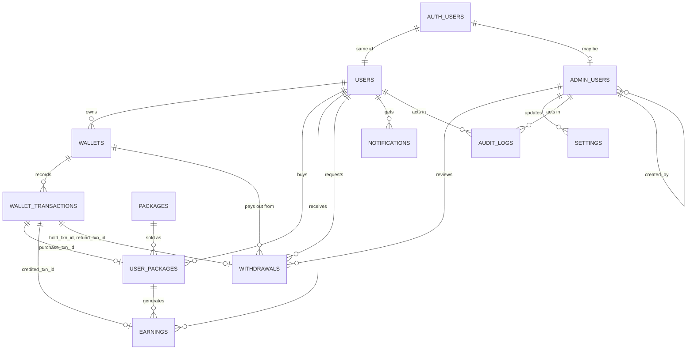

# TeenVest database

PostgreSQL on Supabase. Apply the files in `supabase/migrations` in order.

| File | Contents |
| --- | --- |
| 0001 | Extensions, enum types, `set_updated_at()` |
| 0002 | `admin_users`, `users`, `settings`, `wallets`, `packages` |
| 0003 | `wallet_transactions`, `user_packages`, `earnings`, `withdrawals` |
| 0004 | `notifications`, `audit_logs` |
| 0005 | Triggers and `post_wallet_transaction()` |
| 0006 | Row level security and privileges |
| 0007 | Default settings |

## ERD

## Relationships

| Parent | Child | Key | Delete rule |
| --- | --- | --- | --- |
| auth.users | users | `users.id` | cascade |
| auth.users | admin_users | `user_id` | cascade |
| users | wallets | `user_id` | restrict |
| wallets | wallet_transactions | `(wallet_id, user_id)` | restrict |
| users | user_packages | `user_id` | restrict |
| packages | user_packages | `package_id` | restrict |
| wallet_transactions | user_packages | `purchase_txn_id` (unique) | restrict |
| user_packages | earnings | `(user_package_id, user_id)` | restrict |
| wallet_transactions | earnings | `credited_txn_id` (unique) | restrict |
| wallets | withdrawals | `(wallet_id, user_id)` | restrict |
| wallet_transactions | withdrawals | `hold_txn_id`, `refund_txn_id` (unique) | restrict |
| admin_users | withdrawals | `reviewed_by` | set null |
| admin_users | settings | `updated_by` | set null |
| users | notifications | `user_id` | cascade |
| users, admin_users | audit_logs | `actor_user_id`, `actor_admin_id` | restrict |

## Design decisions

**Users.** `auth.users` holds credentials. `public.users` holds the profile and shares the same id, so it has no default. A trigger creates the profile and a default wallet on signup. Admins live in `admin_users` and point at `auth.users`, so an admin does not need a member profile.

**Money.** All amounts are `numeric(14,2)`, never floats. `wallets.balance` is only changed by `post_wallet_transaction()`. That function locks the wallet row, refuses a negative balance, writes the ledger row with `balance_after`, and returns the earlier row if the same `idempotency_key` is sent twice. Only the service role can call it. A check constraint on `wallets.balance` is the last line of defence.

**Ledger.** `wallet_transactions` is append only. Triggers block update and delete. To fix a mistake, post a `refund` or `adjustment` entry. Because of that, it has no `updated_at` or `deleted_at`. `audit_logs` follows the same rule.

**Same owner guarantee.** Child tables use composite keys such as `(wallet_id, user_id)`, so the database rejects a transaction, earning or withdrawal that mixes one user with another user's wallet or package.

**Snapshots.** `user_packages` copies price, rate and interval at purchase time, so later edits to a package never change what a member already bought.

**No double payouts.** `earnings` has a unique key on `(user_package_id, period_start)`, so a payout job that runs twice cannot pay twice.

**Soft delete.** Every table except the two append-only ones has `deleted_at`. Unique rules use partial indexes with `where deleted_at is null`, so an email, slug or setting key can be reused after a soft delete. Queries and policies must filter `deleted_at is null`. Restrict rules mean a user with financial history cannot be hard deleted, which is intended.

**Security.** RLS is on for all 11 tables. Members can read only their own rows. Members can update only `username`, `display_name`, `avatar_url` and `phone` on their profile and `read_at` and `deleted_at` on notifications, through column grants. Everything else is written from server code with the service role. Admins get read access through `is_admin()`. Anonymous visitors can read public settings only.

## Withdrawal flow

1. Server creates a `withdrawals` row and calls `post_wallet_transaction(... 'withdrawal', 'debit' ...)`, saving the result in `hold_txn_id`. Funds leave the balance right away.
2. An admin approves or rejects it and `reviewed_by` and `reviewed_at` are set.
3. On rejection or failure the server posts a `refund` credit and saves it in `refund_txn_id`.
4. On payout, status becomes `paid` and `processed_at` is set.

## Constraints

| Table | Main checks |
| --- | --- |
| users | username format, date of birth range, uppercase country code, guardian consent needs a guardian email |
| wallets | balance >= 0, uppercase currency, one wallet per currency per user |
| packages | price > 0, rate between 0 and 1, positive interval, duration >= interval, slug format |
| wallet_transactions | amount > 0, balance_after >= 0, type must match direction, reference type and id set together, unique idempotency key |
| user_packages | amount > 0, `ends_at > starts_at`, cancelled status matches `cancelled_at`, one purchase per ledger row |
| earnings | amount > 0, `period_end > period_start`, credited needs a ledger row, one earning per package period |
| withdrawals | amount > 0, 0 <= fee < amount, `net_amount` generated, rejected needs a reason, approved or rejected needs `reviewed_at`, paid needs `processed_at` |
| notifications | title not blank |
| audit_logs | actor type is user, admin or system and matches the actor column used |
| admin_users | one active admin row per auth user |
| settings | key format, one active row per key |

## Indexes

| Table | Index | Purpose |
| --- | --- | --- |
| users | unique email, unique username (active rows) | Login and lookups |
| users | status, created_at | Admin lists |
| admin_users | unique user_id, role | Admin checks in `is_admin()` |
| settings | unique key (active rows) | Setting lookups |
| wallets | unique (user_id, currency) | One wallet per currency |
| packages | unique slug, (status, sort_order) | Catalog page |
| wallet_transactions | (wallet_id, created_at desc), (user_id, created_at desc), (reference_type, reference_id) | History and reconciliation |
| user_packages | (user_id, created_at desc), package_id, partial on `next_payout_at` for active rows | Member view and payout job |
| earnings | (user_id, created_at desc), partial on pending | Member view and crediting job |
| withdrawals | (user_id, created_at desc), wallet_id, reviewed_by, partial queue on pending, approved and processing | Member view and admin queue |
| notifications | (user_id, created_at desc), partial on unread | Inbox and unread badge |
| audit_logs | (entity_table, entity_id, created_at desc), actor user, actor admin, created_at desc | Investigations |

For a very large `audit_logs` or `wallet_transactions` table, consider monthly partitioning on `created_at` later.
